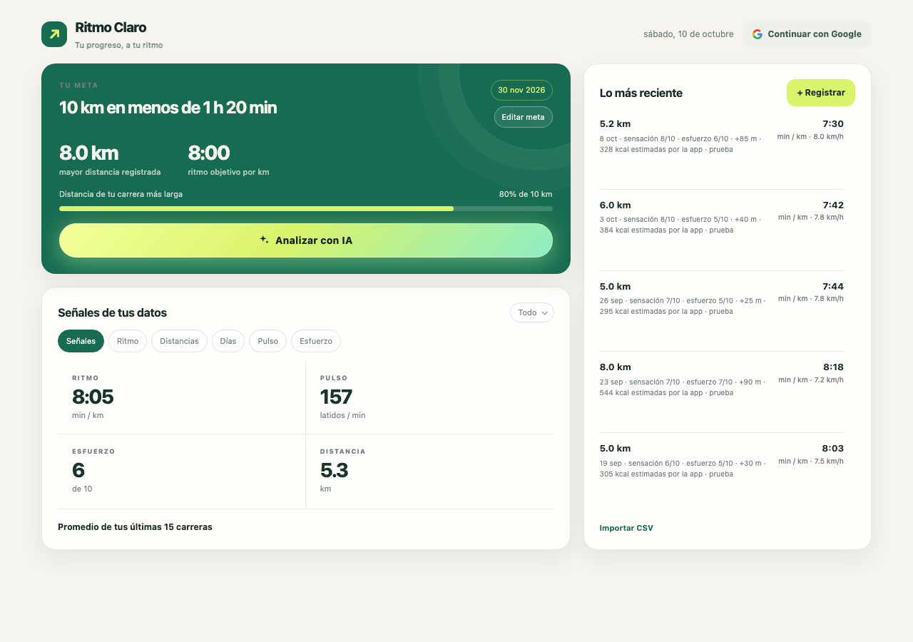

# Ritmo Claro

**See how your running is really going, toward a goal you set yourself.**



## What it does

- **Trends that compare like with like:** pace, pulse, and effort only across similar distances.
- **Your goal, your terms:** any distance, time, and date. It gives context and never hides a run.
- **An AI coach in plain Spanish:** an open-weight model reads your history. If it's unavailable, you still get a calculated reading.

## Run it

```bash
npm install
npm run dev
```

## Built with

Cloudflare Workers · Workers AI (Qwen 3.8 27B, open-weight)
